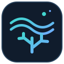

# CaperPlus Q2 for Home Assistant



Version **0.2.2** · [Änderungsprotokoll](CHANGELOG.md) ·
[Releases](https://github.com/xsiimonox/caperplus-home-assistant/releases)

**Status: experimentell.** Die Datenpunktdefinition wurde erfolgreich aus der
Cloud abgerufen. Anmeldung, Messwerte und Kalibrierung sind noch nicht an
einem echten Q2 in Home Assistant getestet. Ein erfolgreicher HTTP-Aufruf
allein bestätigt keine erfolgreiche Kalibrierung.

Home Assistant-Anbindung für CaperPlus Q2. Der empfohlene Weg verwendet die
Gizwits-Cloud, die auch die CaperPlus-App nutzt. Er benötigt weder die IP des
Geräts noch Änderungen an dessen Firmware. Die bisherige App bleibt nutzbar.

## Cloud-Integration installieren

1. Den Ordner `custom_components/caperplus` in das
   `custom_components`-Verzeichnis deiner Home-Assistant-Konfiguration kopieren.
2. Home Assistant neu starten.
3. **Einstellungen → Geräte & Dienste → Integration hinzufügen** öffnen und
   nach **CaperPlus Cloud** suchen.
4. Mit dem Konto anmelden, das du auch in der CaperPlus-App nutzt.

Die Integration legt für jedes Q2 pH-, Wassertemperatur-, TDS- und
WLAN-Signal-Sensoren an. Werte werden etwa einmal pro Minute aus der Cloud
abgefragt.

## Aquarium-Oberfläche in der Seitenleiste

Ab Version 0.2.0 erscheint nach Einrichtung und Neustart automatisch
**CaperPlus Aquarium** in der Home-Assistant-Seitenleiste. Eine eigene
Dashboard-YAML ist dafür nicht nötig.

- Dunkle Meerwasser-Optik mit Türkis- und Blautönen, auch für das Smartphone.
- Geräteauswahl bei mehreren Q2-Geräten.
- Aktueller pH, Wassertemperatur und TDS mit Verknüpfung zum HA-Detaildialog.
- Separate Verlaufskurven mit Zeitachse und Minimum/Maximum: 6 h, 24 h, 7 Tage.
- WLAN-Signal und Zeitpunkt der letzten HA-Zustandsaktualisierung.
- Geführte Kalibrierung mit Pufferwahl, Bestätigung der Vorbereitung und
  Rückmeldung nach Abschluss oder Fehler.

Die Kurven benötigen die Home-Assistant-Komponenten `history` und `recorder`
(üblicherweise über `default_config` aktiv). Die Q2-Sensoren dürfen von der
Aufzeichnung nicht ausgeschlossen sein. Bei einer Neuinstallation entstehen
Verläufe erst im Betrieb. Es werden keine Hersteller-Cloud-Historien importiert.
Der Zeitstempel ist der HA-Zustandszeitpunkt, kein Nachweis für eine neue
Messung am Gerät. TDS ist kein Ersatz für eine Salinitätsmessung im Meerwasser.

Nach einem Update den vollständigen Ordner `custom_components/caperplus`
einschließlich `www` ersetzen und Home Assistant neu starten. Wenn das Panel
fehlt oder veraltet aussieht, die Browserseite neu laden. Das Seitenleistenpanel
nutzt die Geräte- und Entitätsregistrierung von Home Assistant; der angemeldete
HA-Benutzer benötigt Zugriff auf diese Registrierungen.

## pH-Sonde kalibrieren

Die Q2-Firmware unterstützt die Kalibrierung über die Gizwits-Steuer-API. Die
Integration bildet den in der App gefundenen Ablauf ab: Sie übermittelt den
gewählten Pufferwert, wartet auf die Bestätigung des Geräts (bis zu 180
Sekunden) und meldet Zeitüberschreitung oder einen Gerätefehler.

Vor dem Start:

1. Eine frische, passende pH-Pufferlösung bereitstellen (Q2 unterstützt u. a.
   pH 4.00, 6.86, 7.00, 9.18, 9.21 und 10.00).
2. Sonde mit destilliertem Wasser spülen und vorsichtig abtupfen.
3. Sonde in die ausgewählte Lösung geben und warten, bis der Messwert stabil
   ist. Den Pufferwert passend zur Temperatur der Lösung wählen.
4. In Home Assistant **Entwicklerwerkzeuge → Aktionen** öffnen und die Aktion
   `caperplus.calibrate_ph` ausführen. Q2-Gerät und Pufferwert auswählen.
5. Die Sonde während des Ablaufs in der Lösung lassen. Erst nach der
   Abschluss der Aktion entnehmen; danach spülen. Bei einem Fehler zeigt Home
   Assistant eine Fehlermeldung. Den Messwert danach mit der Pufferlösung prüfen.

Diese Aktion kalibriert einen Pufferpunkt pro Aufruf. Wiederhole den Ablauf
mit einem zweiten geeigneten Puffer nur, wenn das für deine Messung nötig ist.
Während eines laufenden Vorgangs keine zweite Kalibrierung starten. Der
Home-Assistant-Sensorwert wird nach Abschluss aktualisiert.

## Beispiel für ein Dashboard

```yaml
type: entities
title: Aquarium – Wasserwerte
entities:
  - sensor.caperplus_q2_ph
  - sensor.caperplus_q2_wassertemperatur
  - sensor.caperplus_q2_tds
  - sensor.caperplus_q2_wlan_signal
```

## Alternative: ESPHome-Firmware

Der Ordner `esphome/` enthält eine UART-basierte Firmware-Variante für den
internen ESP-12F. Diese Methode setzt Lötausrüstung und einen 3,3-V-USB-UART-
Adapter voraus und ersetzt die Original-Firmware. Damit gehen die
CaperPlus-App und deren Cloud-Anbindung verloren. Ein Firmware-Backup vor dem
Flashen ist zwingend ratsam. Die Cloud-Integration ist die empfohlene Wahl,
wenn du die App weiter verwenden möchtest.

Die ESPHome-Konfiguration benötigt folgende Einträge in `secrets.yaml`:

```yaml
wifi_ssid: "Mein-WLAN"
wifi_password: "mein-wlan-passwort"
caperplus_fallback_password: "mindestens-acht-zeichen"
caperplus_api_key: "BASE64_API_KEY_AUS_ESPHOME"
caperplus_ota_password: "langes-ota-passwort"
```

Vor dem Flashen Original-Firmware sichern:

```sh
esptool -p <PORT> -b 460800 read_flash 0 0x400000 caperplus-q2-original.bin
```

## Datenschutz und Betrieb

Ab Version 0.2.2 verwendet ausschließlich der Gizwits-Client zusätzlich die
vom Server benötigte TLS-1.2-Cipher `AES128-SHA`. Zertifikats- und
Hostnamenprüfung bleiben aktiviert. Die TLS-Einstellungen anderer
Home-Assistant-Integrationen werden nicht verändert.

Die Cloud-Variante sendet die Zugangsdaten zur Gizwits-Cloud über HTTPS und
fragt dort die gebundenen Q2-Geräte ab. Das Passwort wird als Config-Entry in
Home Assistant gespeichert. Die Sensorwerte sind deshalb von Internetzugang
und Verfügbarkeit des Gizwits-Dienstes abhängig.

## Entwicklung und Quellen

- Der Q2-Pufferablauf, die Produktkennung und die Gizwits-Endpunkte wurden aus
  dem mitgelieferten CaperPlus-App-Bundle analysiert.
- Die [Gizwits OpenAPI](https://docs.gizwits.com/en-us/cloud/OpenAPI.html)
  beschreibt Login, Geräteliste und neueste Messwerte.
- Die UART-Alternative orientiert sich an der
  [Q2-ESPHome-Anleitung](https://community.home-assistant.io/t/caperplus-q2-ph-tds-meter-integration/818577)
  und der [Q2-UART-Implementierung](https://gist.github.com/tjunussov/5b53057826fd5d4c90b121ba6d225cbd).

Beiträge und Fehlerberichte sind willkommen. Bitte keine Kontopasswörter,
Tokens oder privaten Gerätekennungen in Issues posten.
